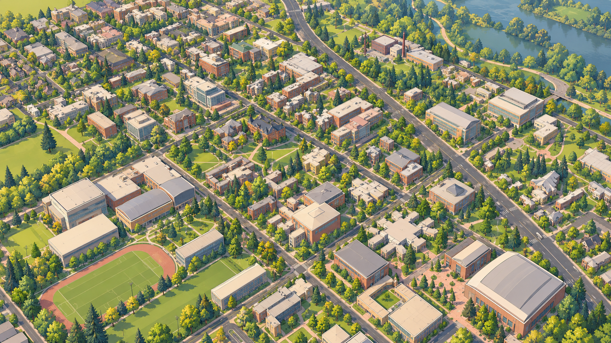

[English](README.md) | **简体中文** · [设计档案](../README.zh-CN.md)

# Open Campus: UO — 建筑卡通写实

美术档案 v1.0 · 2026-10-31 · **推荐的后续画风**

[分享对话](https://chatgpt.com/share/6ae5adf2-4a74-83e8-b001-f9de17509c56)比较了写实、风格化 PBR、低多边形、像素／体素与漫画方向；用户认可克制的 Architectural Toon 概念图后，最终规范定名 **Architectural Toon Realism**：真实可辨识的校园结构、自然材质、柔和 2–3 阶明暗、选择性描边，远景像精致建筑沙盘。

通用规范已归入[上游 style 库](https://github.com/williamQ96/open-geospatial-to-3d-reconstruction-pipeline/tree/main/style/architectural-toon-realism)，作为未来地图**默认推荐**方向，同时鼓励作者探索其他画风，并不强制采用。

## 原始 mockup

**这是美术概念图，不是准确 UO 重建或当前网页截图。** 原始 1672 × 941 PNG 字节不变；建筑、道路细节、河流、运动场与植被不能成为地理依据。见[来源、AI 生成说明与校验值](provenance.json)。

## 调色板与档案

以下 sRGB 色值来自最终互动调色板，原样保留于 [palette.json](palette.json)。它们是材质建议，不是 UO 官方色、测量反射率或测试过的 UI 对比度色组。材质族内应保留自然变化。

| Material | sRGB HEX |
| --- | --- |
| Brick Red | `#B96F55` |
| Warm Stone | `#E4D6BB` |
| Roof Gray | `#A8ADB0` |
| Glass Blue | `#8FAEAE` |
| Grass Green | `#91B66F` |
| Foliage Green | `#658B54` |
| Deep Evergreen | `#385A45` |
| Path Sand | `#CDBB9F` |

- [分享对话最终规范原文整理](source-guide.zh-CN.md)
- [可复用 prompt](style-prompt.txt)
- [上游通用规范](https://github.com/williamQ96/open-geospatial-to-3d-reconstruction-pipeline/tree/main/style/architectural-toon-realism/README.zh-CN.md)与[实现／成本／运行评估](https://github.com/williamQ96/open-geospatial-to-3d-reconstruction-pipeline/tree/main/style/architectural-toon-realism/implementation.zh-CN.md)
- [机器可读来源记录](provenance.json)

## UO 应用计划

保持现有历史点云／近似模型的来源、日期、稳定 ID 与质量标记，不把概念图或换材质当作精确重建。

| 阶段 | UO 工作 | 扩展前验证 |
| --- | --- | --- |
| 环境 | 独立核验地面分类、草坪、人行路径与本地植被，建立复用树木库 | 核验位置与来源；当前道路仍是中心线加估算宽度 |
| 材质 | 以原色板为起点组织砖、石、屋顶、玻璃、铺装族 | 不让所有楼同色，保留标准 PBR 与现有 logo |
| 地标试点 | 优先完成 Knight Library—EMU—Johnson Hall 小片区域，先核验入口、屋顶与立面参考 | 比对近中远视角，确认资料覆盖与精度，再扩展 534 个占位体块 |
| 导航 | 保留 Follow、第一人称、Overview、搜索、标签、小地图 | 植被与描边不遮挡人物、目标、路线，选中标签优先 |
| 渲染与规模 | 评估柔和 Toon 与可关闭描边，再按测量结果引入细节层次／实例化／压缩 | 同几何对比 PBR，记录帧耗时、内存、draw calls 和下载成本 |

以上试点、三模式细化与量化验收是本次整理补充的工程计划，尚未完成。最终规范选择暖日光；早先阴天建议保留为后续可选变体。

## 维护边界与状态

UO 仓库负责本地资料、建筑身份、模型细化、地域配色／植被和品牌；上游负责通用方法与未来数据中立的渲染适配器。地理数据、Blender 源资产、标准 GLB／材质、渲染风格分层；三模式共用世界与对象 ID。

**[首个视觉闭环](../../docs/zh-CN/visual-pilot.md)已实现照片参考地标、通用建筑、示意景观和 Toon／PBR 切换。** 原始概念档案不参与网页下载；其余校园仍是白模。精确立面、室内、LOD 和更多主题仍待完成。

## 署名与来源范围

署名 **OpenCampus Architectural Toon Realism — Zhongyi “William” Qiu and contributors**，保留 [UO](https://github.com/williamQ96/open-campus-uo) 与[上游档案](https://github.com/williamQ96/open-geospatial-to-3d-reconstruction-pipeline/tree/main/style/architectural-toon-realism)来源、[CC BY 4.0](../../LICENSES/CC-BY-4.0.txt)并标记修改。原创文档／设计贡献和项目拥有的可版权化 AI 图像权利按此政策提供，不主张画风本身排他权。第三方参考图不复制或重新许可。开头两张截图保留为来源上下文，公开分享未暴露可下载原件，故未伪造补图。现有 [Open Courtyard 标识](../open-campus-philosophy.md)保留。见[许可政策](../../LICENSING.zh-CN.md)。
