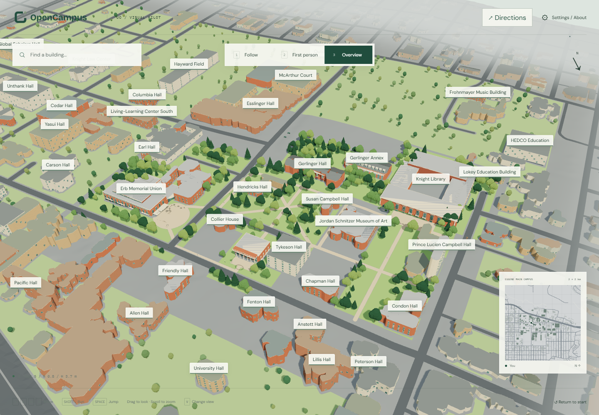
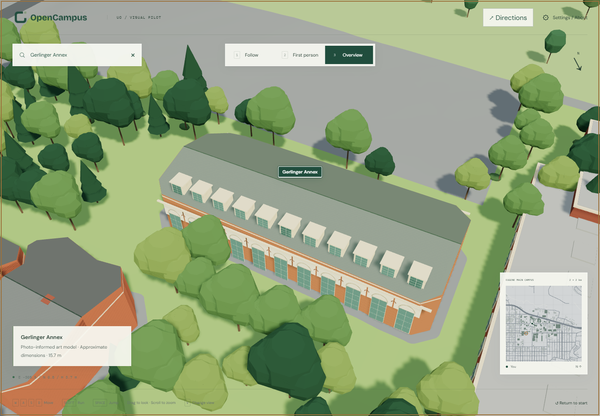

# Campus expansion: photo grammar and a quiet background

**English** | [简体中文](zh-CN/campus-expansion.md)

Campus expansion batch, 2026-10-31. Architectural Toon Realism continues as the art direction. This pass adds recognizable patterns and coherent surroundings; it does not attempt photographic replication or claim current survey accuracy.



## Scene hierarchy

| Tier | This scene | Treatment |
| --- | --- | --- |
| Photo-informed landmarks | Knight Library, EMU, Johnson Hall, Gerlinger Hall and Gerlinger Annex | Distinct silhouettes, sash/window rhythms, pale trim, awnings, arches, dormers and roof accents. Dimensions and hidden elevations remain inferred. |
| Campus art-priority area | 135 source building records, including the landmarks | Brick/stone palettes, simple roofs, repeated openings and restrained entrances; more detail around named buildings. The editable polygon is an art boundary, not an official property boundary. |
| Background | 399 source building records | A small original open low-poly house/walkup/warehouse vocabulary, seeded palette/roof choices, sparse windows and reduced contrast. Types are illustrative; coordinates and footprints are retained. |

Every one of the **534** historical building records now has stylized appearance. There are **600 illustrative trees**: the existing 300-tree NAIP-guided pilot is retained; another 300 trees and campus lawns are procedurally inferred outside that limited aerial crop. New plantings respect building/road setbacks, but are not a tree inventory.

**Randomness changes appearance, never geography.** Stable IDs seed choices independently so rebuilding or reordering one area does not reshuffle others. Original footprint coordinates, base/roof envelope records, roads, blocks, heightfield, navigation graph and collision catalog are retained. This preserves the existing geographic evidence; it does not improve the accuracy or date of that evidence.

## Photos → patterns → editable geometry

Two additional **2013-10-19 photographs by Rick Obst, CC BY 4.0**, are archived unchanged:

- [Gerlinger Hall](../data/reference-images/photos/gerlinger-hall/exterior-2013.jpg): pediment, symmetric sash bays, burgundy awnings, brick piers and a pale entrance frame. [Source and license](https://commons.wikimedia.org/wiki/File:Gerlinger_Hall_building_on_the_University_of_Oregon_Campus.jpg).
- [Gerlinger Annex](../data/reference-images/photos/gerlinger-annex/exterior-2013.jpg): tall arched openings, pale upper band, circular motifs and repeating dormers. [Source and license](https://commons.wikimedia.org/wiki/File:Gerlinger_Annex_on_the_University_of_Oregon_Campus.jpg).

The originals were downloaded from the photographer's Flickr CDN because the Commons image host was unavailable; byte counts and SHA-1 match the original Commons records. See [license/download evidence](../data/metadata/campus-expansion-photo-evidence.json), [the image register](../data/reference-images/manifest.json) and [credits](../data/reference-images/ATTRIBUTION.md).

New pattern counts, facade orientation, roof proportions and occluded sides are modeling assumptions, not measurements. The Annex's repeated bays are a simplified rhythm rather than a counted replica. Existing Knight Library/EMU/Johnson geometry is retained with shallow frieze, canopy/mullion and sill additions. The earlier [pilot Blender source](../assets/visual-pilot/knight-emu-johnson.blend) is not overwritten. No photographic textures or Google-derived assets are embedded.



## Background haze and cost

**Settings → Display → Background haze** is on by default. It leaves the priority polygon clear and gradually desaturates/tints exterior blocks across a 210 m transition, reaching strength 0.78. It is tied to world coordinates, so orbiting or walking does not make the boundary follow the camera. This provides a soft filtered background while keeping street structure legible. It is a viewer effect; exported GLB materials remain standard PBR.

The effect is evaluated at vertices and interpolated rather than using a screen blur pass. Anonymous buildings are batched into **21 runtime meshes**, retaining **470 source IDs** in metadata; **64 individual building groups** remain selectable, including all 63 named buildings and the retained unnamed pilot asset. New meshes use a shared vertex-color palette. Exact terrain-draped surfaces declare their offset so navigation/NPC height sampling can reuse the heightfield instead of repeatedly raycasting large lawn meshes. Raised untagged surfaces retain ray sampling.

The expanded GLB is about **25.4 MB**, versus about 11.65 MB for the old 14-building pilot; the base terrain download remains separate. The larger coverage costs bandwidth despite batching. A representative settled software-rendered Overview used **209 draw calls** with activity enabled; this is a diagnostic observation, not a hardware FPS guarantee. Lawn normals are shared to reduce duplicate vertices; shadows remain static. Historical assets remain available but the viewer loads only the new presentation GLB.

## Source, rebuild and correction

- Editable source: `assets/campus-expansion/eugene-campus.blend`, with all **534 building objects independently editable** (542 total source meshes). Only export copies are merged into the 93 runtime meshes.
- Runtime: `apps/web-preview/public/scene/campus-expanded.glb` and `presentation.json`.
- Parameters: [campus-expansion.json](../configs/campus-expansion.json).
- Per-ID choices, source geometry, context batch membership and source hashes: [audit](../data/metadata/campus-expansion-audit.json).
- Reconstruction and earlier art pins retain their historical meaning. This new art layer records the local, uncommitted upstream method revision and actual module hash; the publication batch promotes the viewer lock to a clean committed upstream revision. The art layer retains its actual build-time dirty state and module hash; it is not relabeled as regenerated.

From the repository root, with the upstream Python environment and Blender 4.5:

```powershell
python scripts/prepare-campus-expansion.py
blender --background --factory-startup --python scripts/build-campus-expansion.py
python scripts/check-campus-expansion.py
```

The first script needs upstream geospatial dependencies; the Blender script consumes prepared JSON without installing GIS dependencies into Blender. Keep the original pilot and preserve manual edits to the expanded source before regeneration. Source-photo PNG/JPEG bytes and model binaries are checked exactly. For text inputs, retain the raw build-byte hash and use an additional UTF-8/LF-normalized hash for cross-platform comparison; this does not rewrite historical provenance.

Next corrections should prioritize entrances, landmark silhouette, facade orientation and actual campus paths before small ornament. Generic named buildings and background types are explicitly provisional. Existing navigation remains approximate outdoor routing; decorative art does not establish access or collision accuracy.

Final local verification: 32 upstream Python tests, 15 upstream JS tests and 4 template browser tests passed; downstream 12 JS tests and all 13 browser tests passed, including a repeat after the final export. Formatting, both production builds, approved image/media and model-byte audits passed. Reopening the saved Blender verified all 534 independently editable identities. Raw build-byte hashes are retained, while normalized text digests provide portable comparison across Git line endings.

See the [upstream recommended hierarchy](https://github.com/williamQ96/open-geospatial-to-3d-reconstruction-pipeline/blob/main/docs/scene-hierarchy.md) and the project-only [development log](../DEVELOPMENT_LOG.md). Current publication and deployment status is recorded in that log; the earlier local verification above describes the asset build snapshot.
