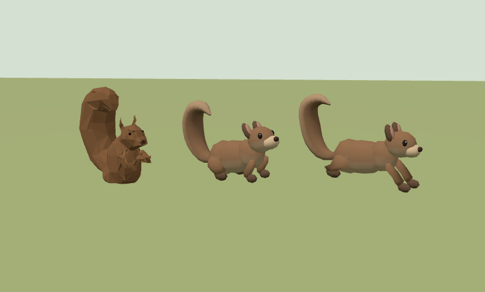

# Campus activity L2 review

LIFE-01 covers generic campus students and squirrels. The default scene uses the revised motion and models. The named outdoor figure has its own inventory row.

## Students and paths

The existing Kenney rig retains the seeded clothing, hairstyle, bag and body proportions. Normal walking uses a 60 percent stance. The supporting shoe moves back by the distance traveled while the other shoe lifts and swings forward. The pose bends each knee to reach the assigned ankle position. Faster NPCs use the existing running clip. The player avatar and named figure continue to use their established motion. [Human walking reference](https://pmc.ncbi.nlm.nih.gov/articles/PMC2894890/)

On a straight 1.4 m/s test, each shoe's mean horizontal ankle slip during sampled support fell from 1.31–1.39 m/s to 0.001–0.027 m/s across two body widths. The largest measured sole penetration was 2.5 mm with the new walk. Sharp turns, grade breaks and starts or stops remain approximate.

The new west walk is 181.91 m in plan. It replaces the former segment that crossed 128.39 m of modeled lawn inside the Quad. Students, cyclists and scooters share the retained route ID and the detour mask uses the new paving. Eight squirrel paths are fitted onto the revised lawns, clear of the registered tree stems. The asset keeps the eight illustrative climbing routes and the prior activity file as the surface fallback. [Memorial Quad surface review](paving-corridors-l2-2026-11-26.md)

## Squirrels

The original replacement has a tapered muzzle, ears, four weighted paws and a curved bushy tail. Nine joints animate the body, paws and tail. The same mesh bounds on grass, pauses and pitches into authored climbing paths. Brown body colors vary by seed. The design uses regional squirrel anatomy as a reference and does not assign a species or describe observed habitat use. [OSU Extension reference](https://extension.oregonstate.edu/catalog/em-9573-how-help-oregons-native-western-gray-squirrel)

The active model uses one mesh with 1,326 triangles, compared with 1,060 for the earlier model with eye accents. In a straight ground-bound check, 124 stance samples stayed 3 mm above the test plane and the swing lifted the paws by up to 72 mm. The single-mesh GLB contains Bound, Perch and Climb clips. The viewer uses the same pose function with runtime travel distance and route grade. When the new GLB fails its byte check the viewer uses the earlier CC0-derived model.

From `apps/web-preview`, run `node scripts/export-campus-squirrel.mjs <output-file>` to reproduce the GLB. The original shape and joint motion are editable in [squirrel-model.js](../apps/web-preview/src/squirrel-model.js). The new model output is CC BY 4.0. The Kenney mesh and original squirrel asset retain their existing credits and terms.

## Scene verification

All 1,075 downward ray samples hit the intended GLB paving or lawn. Route heights stayed within 17.1 mm of the surface. Two exports, the installed assets, the build and served bytes matched. Desktop and phone production previews showed 524 selectable buildings and 0, 7, 29 and 74 activity colliders across the four density levels. Desktop No activity measured 211 draws in both the refined and earlier squirrel cases. Two older browser assertions require fewer than 180 draws for that view.

This checkpoint is local to the release worktree.
