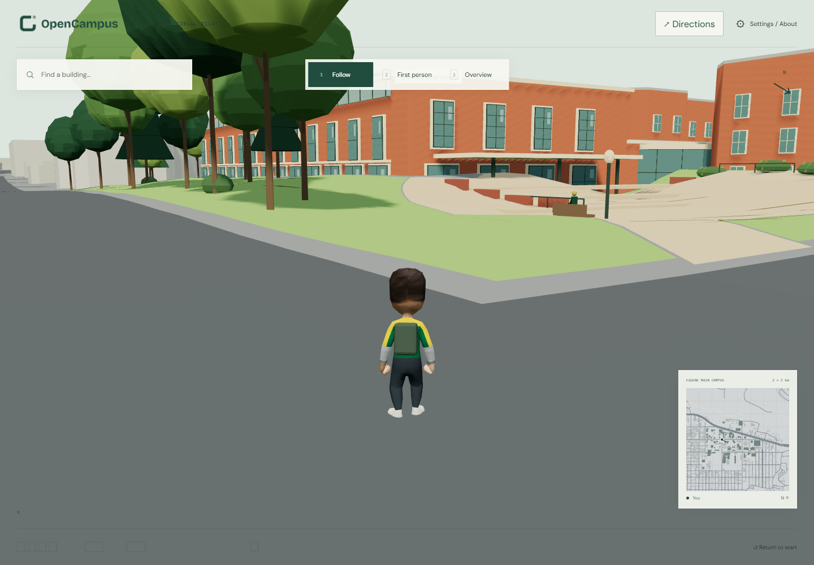
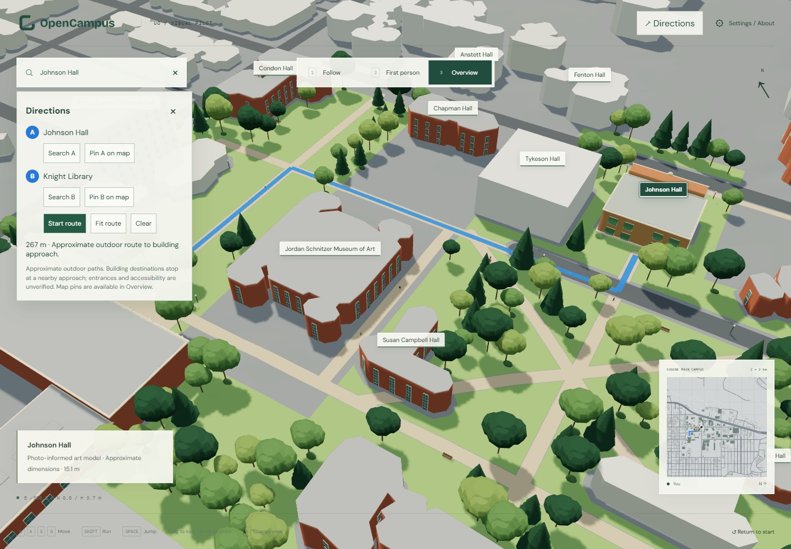

# Campus life and outdoor navigation

**English** | [简体中文](zh-CN/campus-life-navigation.md)

Version 0.10 adds an openly reusable rigged hero, scripted campus activity, parked vehicles and approximate outdoor directions. Existing Follow, First person, Overview, search, jump, minimap and split-screen touch controls remain available.

## Use

- **Directions** is beside Settings. In **Overview**, choose **A** and **B** with **Search A/B** (the existing building search) or **Pin A/B on map**. A pin must be on clear ground outside building envelopes. While pinning, the panel collapses to leave the map accessible. Start route frames the route; Fit route frames it again.
- In **First person** and **Follow**, **A is captured from your position when you press Start route**. Choose B with Search B. The blue start circle and complete route stay fixed as you walk; your location marker and white chevrons keep moving. Follow/First person switches retain that starting point. Press Start route again to capture a new origin at your current position. Overview keeps its independent manual A; returning to a walking view restores its saved origin. Clear or choosing a new endpoint resets it. No teleportation occurs.
- Blue ground ribbons and animated **white chevrons run A → B**; the minimap also shows the route. A destination message appears near the final approach. Clear removes the route and endpoints; closing the panel keeps navigation running.
- **Settings → Campus life** now uses one **No / Low / Mid / High** density slider, default **Mid**. No removes moving actors, parked props and their collision bodies. See [iteration 11: ambience, sound and feedback](ambience-feedback.md).

## Hero and assets

The hero and eight walking students use Kenney's [Animated Characters 3](https://kenney-assets.itch.io/animated-characters-3), a **CC0** rigged generic human. Forest-green/gold clothes, charcoal trousers, cream shoes and an original backpack evoke UO colors without logos or mascots. The generic model is not a depiction of a real student. Idle and slowed locomotion are blended; jumping retains existing ground physics. The source run cycle is a first-pass walk approximation.

- [Original source pack, selected FBX inputs and checksums](../data/asset-sources/README.md)
- [Unchanged texture and credit record](../data/reference-images/ATTRIBUTION.md#kenney-student-skin)
- `assets/characters/campus-student.blend` includes the packed texture, skeleton, materials and actions.
- `apps/web-preview/public/characters/campus-student.glb` is the portable runtime model (~0.25 MB).
- `assets/props/campus-props.blend` and `apps/web-preview/public/props/campus-props.glb` contain original cars, van, pickup, bicycle/rider and scooter/rider. They are generated by the shared `src/props.js`; source code is Apache-2.0 and original model output is CC BY 4.0. The prop GLB is an export library, not an additional runtime download.

The original Kenney mesh, animations and PNG retain **CC0**. Original clothing materials, backpack and procedural models are **CC BY 4.0**; project attribution does not relicense CC0 sources. Credits also appear in About. No Google-derived geometry, textures, imagery or imported data was added.

Rebuild the hero from the repository root using Blender 4.5 LTS:

```powershell
blender --background --python scripts/build-campus-character.py
```

FBX animation rigs and the skinned mesh have different rest poses. The build bakes source world-space bone matrices into target-local poses before GLB export; copying actions directly would produce incorrect T poses. Source files and the generated Blender project are retained for later correction.

To export the procedural props, keep the Vite development server on port 5173, then run `npm run export:props` from `apps/web-preview` (requires installed Chrome/Playwright). From the project root, `blender --background --python scripts/import-campus-props.py` imports that GLB and saves the editable Blender library. Exported model hashes are recorded in `data/asset-sources/manifest.json`.

## Scripted activity

The default Mid scene has **8 walkers, 2 bicycle riders, 2 scooter riders, 4 road cars, 8 squirrels and 5 parked props**. Actors follow fixed authored routes and reverse at ends; squirrels pause periodically. Upright collision capsules let actors yield to each other, the player and parked props. The player checks these volumes with substeps. Congestion may pause an actor; this is not full traffic AI or rigid-body physics. Activity pauses during dialogs. Moving objects do not cast baked static shadows. Density, sound, motion, feedback, counts and limitations are documented in the [current interaction guide](ambience-feedback.md).

The pilot's historical footprint/terrain mismatch and decorative terraces remain approximate. Neither navigation nor NPC movement solves stairs, accessibility, indoor paths, fences, access hours, or current construction. Building searches end at a nearby graph approach, **not a verified entrance**. A failed route reports no connection instead of drawing through buildings.

## Rebuild navigation

With the upstream Python environment available, run `python scripts/prepare-explorer-life.py` from the repository root. This creates `public/scene/navigation.json` (7,580 ENU nodes / 7,705 edges) from the existing centerlines plus authored pilot paths, and `activity.json` with local route/parking choices. It retains the base manifest SHA-256; the 2008 measured base and visual-pilot GLB are unchanged.

The upstream builder nodes intersections, samples centerlines every ~7 m, excludes buffered building interiors and inserts only clear short gap connectors. Browser routing uses weighted shortest paths, collision-checked endpoint attachments and exterior building approaches. The ribbon follows terrain/illustrative landscape surfaces, with depth bias above paving; buildings can still occlude it. Chevrons are instanced and do not require a mesh per arrow.

## Verification

New tests cover blocked/disconnected graph paths, graph obstacles/intersections, animated chevron direction, the hero/default counts, activity motion, density levels, collision volumes and clean-mode rendering, Overview A/B, fixed walking origins after movement, view switches, explicit restarts and a real phone-sized canvas pin. Existing search, jump, terrain, camera and mobile controls are retained. See the repository CI for current results. The preview remains an approximate art/navigation prototype, not a dependable campus wayfinding service.
## Visual checks





Local verification on 2026-10-31: downstream 10 unit tests and 13 browser tests passed; upstream 29 Python tests, 12 JS tests and 4 browser tests passed, with template build, wheel packaging and image provenance audit passing. A representative settled Overview rendered 196 draw calls with immersion; the same route-framed clean view rendered 93. Counts depend on view/occlusion; tests retain separate enabled/clean budgets rather than promising a device FPS.
