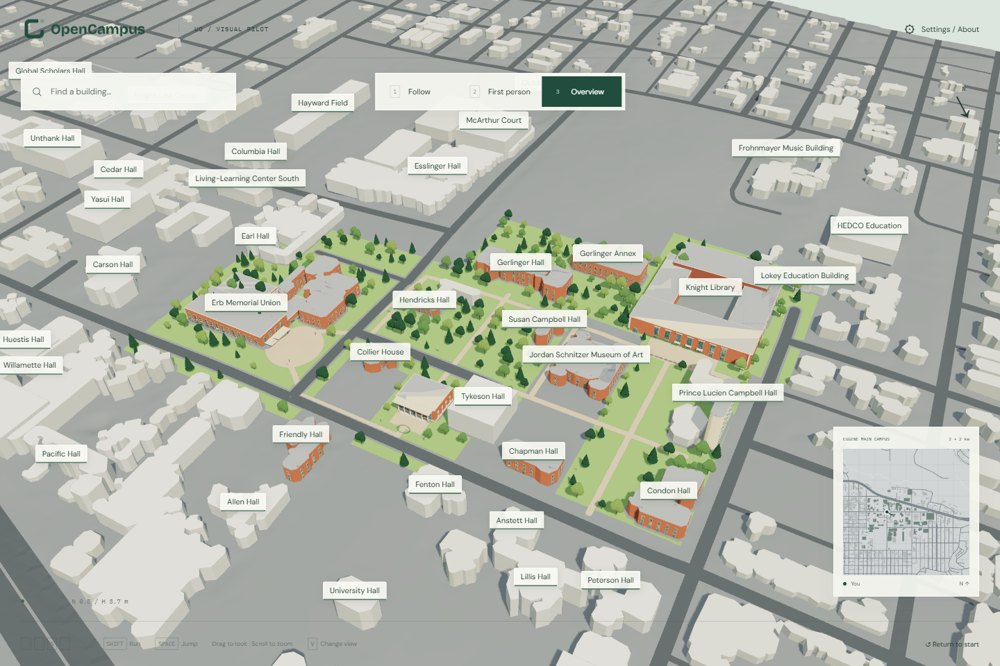
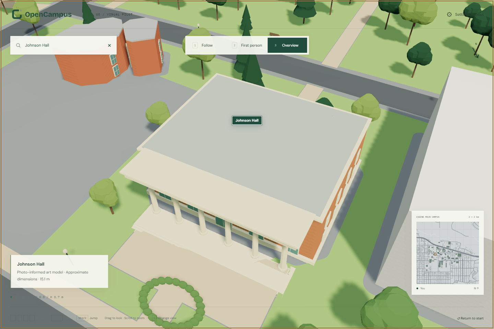

**English** | [简体中文](zh-CN/visual-pilot.md)

# Knight Library–EMU–Johnson Hall visual pilot

Version 0.6 · Architectural Toon Realism · 2026-10-31

The first visual loop adds three photo-informed landmarks, ten stylized historical buildings and one unidentified context envelope, 220 clustered deciduous/conifer trees, planting, benches, lamps, lawn and paved connections. Warm daylight, cooler ambient light, three-tone shading, dark window divisions and pale architectural trim provide the first implementation of the recommended style. Decorative full-screen outline/AO passes are deliberately absent from this pilot.



## Photo references and accuracy

The [reference register](../data/metadata/visual-pilot-references.json) records the original pages, image URLs, observed features and limitations. UO photographs were searched and visually inspected for this work. They remain with their original rights holders, are not redistributed and are not used as textures.

**Reference-archive update:** the [central image directory](../data/reference-images/README.md) now preserves seven separately licensed photographs for future refinement, plus existing project artwork. The UO photos above remain historical link-only records with unverified redistribution rights and explicit replacement IDs. The new archive did not regenerate this pilot's geometry. Capture dates, pre/post-renovation views and facade orientations are recorded so subsequent work can use the approved originals accurately.

| Landmark | Photo-informed features | Reference |
| --- | --- | --- |
| Knight Library | Tall north windows, brick, pale stone cornice/surrounds, three small balconies | [UO exterior photograph](https://cas.uoregon.edu/about/cas-awards/recent-cas-awardees), [architecture archive](https://expo.uoregon.edu/spotlight/history-uo-architecture/feature/knight-library) |
| Johnson Hall | Six-column north portico, brick/stone contrast, broad stair and circular planting motif | [UO photograph](https://news.uoregon.edu/content/uo-sets-record-academic-giving-first-public-year-campaign), [architecture archive](https://expo.uoregon.edu/spotlight/history-uo-architecture/feature/johnson-hall) |
| EMU | Varied brick masses, narrow upper windows, glazed ground floor, canopy and terraced forecourt; curved Fishbowl motif | [UO exterior photograph](https://news.uoregon.edu/content/events-emus-75th-birthday-bring-uo-groups-together), [EMU history](https://emu.uoregon.edu/index.php/about/history) |

These are **approximate art models, not measured facades or a current digital twin**. Window counts, subdivisions, heights, architectural proportions and the modern EMU geometry need further verification. Supporting buildings retain their historical footprint/height envelopes with generic procedural windows. The additional unnamed `roof-39f81f68` remains unidentified; its styling does not establish an identity.

Lawns, new paths, trees, planting and furniture are curated illustrative placements. They are not a tree inventory, access survey, current restoration plan or route recommendation. Existing terrain, base GLB, manifest, stable IDs, source dates and Census road centerlines are unchanged. Added surfaces are intersected with the exact terrain triangles and exclude the original building and road geometry. The 2008 origin of the underlying scene remains explicit.

## Explore

[Open the live map](https://williamq96.github.io/open-campus-uo/). Overview initially frames the pilot; zoom out to see the complete 2 × 2 km context. Search the three landmarks for 45° framing. Follow and First person turn in place; WASD, Shift, Space, mouse drag, Follow zoom, selected labels and the minimap remain available. The original University Street / East 13th Avenue spawn facing EMU is retained, with an open planting sightline toward its entrance.

Settings → **Architectural toon** switches between three-tone shading and standard GLB PBR materials. Wireframe, shadows and building-name controls still work. Walking labels are limited to nearby buildings, with the selected target retaining priority at any distance.

Collision remains based on the existing footprint records; camera rays use the displayed building meshes. Decorative stairs, benches, trees and terraces are not a new navigable collision mesh. The pilot has no interiors, seasonal/weather simulation, LOD/streaming or mobile movement controls.



## Editable and reproducible assets

- [Blender source](../assets/visual-pilot/knight-emu-johnson.blend): separate semantic building/landscape meshes with material slots, camera and lighting.
- [Runtime GLB](../apps/web-preview/public/scene/visual-pilot.glb): standard PBR interchange materials and stable building IDs.
- [Presentation contract](../apps/web-preview/public/scene/presentation.json): overlay hash, source manifest/heightfield hashes, replacement IDs, lighting and initial camera.
- [Art configuration](../configs/visual-pilot.json): illustrative path/lawn placement, deterministic tree seed and pilot settings.
- [Source palette and concept](../design/architectural-toon-realism/README.md).

From this repository, with the documented upstream environment and Blender prepared:

```powershell
& '../open-geospatial-to-3d-reconstruction-pipeline/.venv/Scripts/python.exe' scripts/prepare-visual-pilot.py
& '../open-geospatial-to-3d-reconstruction-pipeline/.tools/blender-4.5.15-windows-x64/blender.exe' --background --factory-startup --python scripts/build-visual-pilot.py
```

The input preparation reuses upstream terrain-draping methodology. Rebuilding the base geospatial scene is a separate deliberate operation: it does not silently overwrite this art layer. Validate the recorded source hashes and replacement IDs before reattaching the layer to a changed scene. Future manual Blender edits should be preserved as source revisions; the procedural generator rebuilds its own authored output, so do not run it over unpreserved manual changes.

## Validation and cost

The pilot's standard-material GLB is approximately 7.9 MB and adds no photo texture downloads, CDN, remote GIS or runtime service. Most detail is grouped by semantic building/material or landscape family. Runtime diagnostics expose draw calls and rendered triangles; tree count is 220. The initial review measured 43–124 draw calls across the three modes on a 1440 × 960 viewport.

Local automated validation covers terrain/collision/jump, three camera modes, spawn, zoom, search framing and selection, labels, narrow layouts, material fallback, wireframe and About disclosure. Upstream additionally tests multi-primitive material selection, safe overlay paths and scaffold copying. `scripts/review-visual-pilot.mjs` captures screenshots and 60 animation-frame samples per mode; output lives in ignored `artifacts/visual-pilot/`.

The diagnostic run used Chrome 155 with ANGLE SwiftShader **software rendering**, with median frame intervals around 158–175 ms. This is not a hardware-GPU performance claim. The complete original terrain is still rendered; terrain chunking/LOD, foliage LOD and broader device profiling remain needed before a performance release. No 60 FPS or mobile guarantee is made. Visual reference quality and fidelity will continue to improve independently of these optimizations.

Code is Apache-2.0; original rights-held models and screenshots follow CC BY 4.0 and the project [attribution policy](../LICENSING.md). Photo references retain their own rights. Reusable presentation loading, material handling and scaffold support are maintained upstream; UO geometry, curated landscape and photo references stay downstream.
