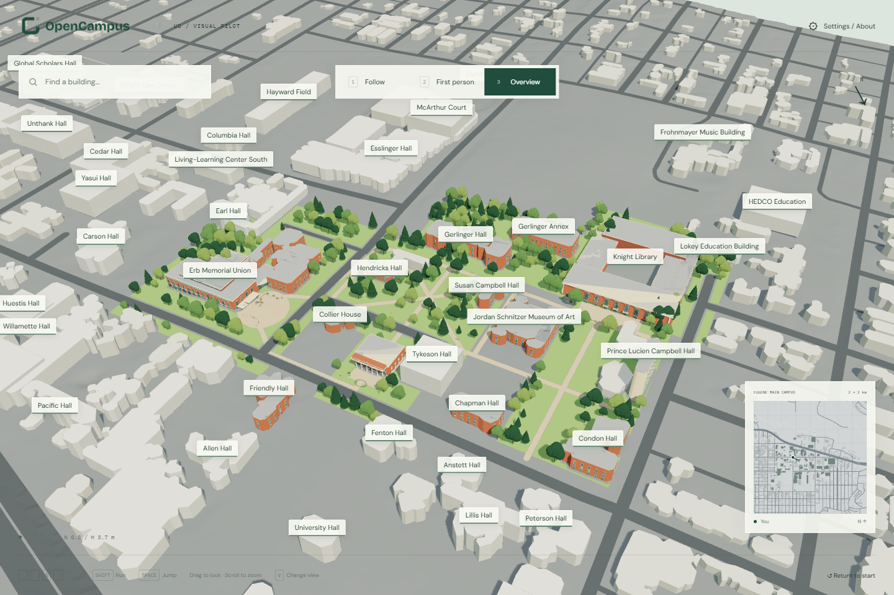
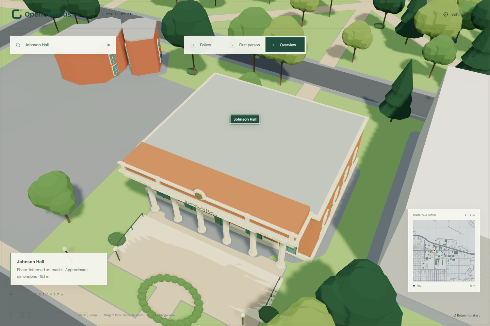

[English](../visual-refinement-v0.7.md) | **简体中文**

# v0.7：模块化地标与航拍引导的景观

2026-10-31 · Architectural Toon Realism

用已归档的 7 张开放许可照片细化 Knight Library、Johnson Hall 和 EMU，增加 **2024-06-08 USDA NAIP 正射航拍**用于树冠／草坪分布与屋顶节奏参考。三视角、搜索、标签、小地图、跳跃与缩放继续可用。



**首轮先做完整、可辨识的场景，精细和写实程度靠长期纠正维护。** 明确记录、可编辑的合理推测不阻断交付。本版是外观美术细化，没有新实测、手机采集、摄影测量、splat 或 AI 几何求解，不是当前精确数字孪生。

采用用户提供讨论中的混合思路：地理骨架＋照片外观＋可重复建筑模块＋通用材质。文件名／hash、已采用与待采集方法见[方法来源](../../data/metadata/refinement-methods-v07.json)。没有导入文档中的第三方插图或私有对话作为项目图像资产。

## 特征与纠正记录

| 对象 | 照片依据 | 推测与后续纠正 |
| --- | --- | --- |
| Knight Library | 多格高窗、砖墙凹口、浅色檐口／饰带、三个阳台、入口灯具 | 窗格／尺寸、装饰、侧后立面、屋顶设备近似；后续核验入口宽度与屋顶翼楼关系。 |
| Johnson Hall | 六柱、柱头、檐饰／女儿墙、圆形饰章意象、宽台阶、背面绿雨棚 | 柱身细节、比例、窗格、台阶高度近似；可用少量实测与连续角部视图校准。 |
| EMU | 2017 砖／玻璃、连续高窗、历史 Fishbowl 弧形玻璃、雨棚与露台 | 屋顶、窗格和露台推测；历史与后期元素构成阶段性混合，不冒充某一年的精确立面；后续核验现代入口与轮廓。 |
| 景观 | 航拍中的暗色、有纹理绿色树冠线索与开敞草坪 | 300 棵树为示意，不是单株测绘；树高、树种、冠幅、林下植被和部分路径为推测。 |



20 个可编辑语义网格覆盖 14 个美术替换建筑 ID 与景观。窗格／柱距参数位于[配置](../../configs/visual-pilot.json)。原 2008 地形、建筑目录、稳定 ID 和 Census 中心线保持原来源；装饰细节不构成台阶碰撞、通行或测绘证据。

## 航拍与植被

来源是航拍正射影像，不是卫星图或 Google 底图。固定选择 USDA raster `m_4412364_sw_10_060_20240608`，保存 540 × 450 m、0.6 m/px、EPSG:3740 的下载 PNG，与当前水平框架一致。[图片](../../data/reference-images/aerial/naip-2024-pilot-rgb.png)、[导出请求／范围／源记录](../../data/metadata/naip-2024-reference.json)、[署名](../../data/reference-images/ATTRIBUTION.md#naip-2024-pilot-rgb)均已归档。

[USDA 官方目录](https://catalog.data.gov/dataset/national-agriculture-imagery-program-naip-imagery)声明公有领域分发。保留机构署名和 `LicenseRef-PD-USGov`，不改授 CC BY／CC0。未导入或描摹 Google 图片／托管三维资产。

算法提取平滑的暗色、有纹理绿色 RGB 线索，按已知北向上坐标采样，结合建筑／道路退让、开敞草坪、间距与出生点面向 EMU 的视线生成树群。可能混淆阴影、灌木和树冠；树高和树种明确为美术参数。新增对角连接与种植为贴合原地形的示意景观。

## 交付与验证

[Blender](../../assets/visual-pilot/knight-emu-johnson.blend) 可编辑，[GLB](../../apps/web-preview/public/scene/visual-pilot.glb) 约 11.65 MB，保留 PBR 与可选 Toon；无照片贴图运行依赖。[presentation](../../apps/web-preview/public/scene/presentation.json)记录图像／资产 hash 与独立美术方法版本，不改写旧重建来源。

[渐进建模主张、立面模块与航拍线索代码](https://github.com/williamQ96/open-geospatial-to-3d-reconstruction-pipeline/blob/main/docs/zh-CN/progressive-modeling.md)回流上游。UO 特定几何、参数和照片留在下游。

本地 6 项地形／移动单元测试、8 项浏览器测试、构建、格式与素材核查通过。浏览器测试覆盖三视角、原地形／碰撞／跳跃、缩放、搜索／标签、窄屏、三个地标与材质回退。上游 25 项 Python 测试包含新增方法。

[资产核查](../../data/metadata/visual-refinement-v07-audit.json)验证建筑 ID、GLB 结构、零照片贴图、来源／模块／资产 hash 以及原历史 manifest 一致性。

[诊断](../../data/metadata/visual-refinement-v07-diagnostics.json)中三模式无页面异常，48–139 draw calls，约 58.8–64 万可见三角形。1440 × 960、Chrome／ANGLE SwiftShader 软件渲染帧间隔中位约 158 ms，不代表硬件 GPU 或 60 FPS；完整地形分块／LOD 仍待实现。图片研究库不增加运行下载。

按 `presentation.json` 的 `art_pipeline.commit` 准备干净上游环境与 Blender 4.5 后，在本仓库执行：

```powershell
& '../open-geospatial-to-3d-reconstruction-pipeline/.venv/Scripts/python.exe' scripts/prepare-visual-pilot.py
& '../open-geospatial-to-3d-reconstruction-pipeline/.tools/blender-4.5.15-windows-x64/blender.exe' --background --factory-startup --python scripts/build-visual-pilot.py
```

重新生成前保留手工细化版本。原创模型 CC BY 4.0、代码 Apache-2.0、图片各自保留许可。[v0.6 报告](visual-pilot.md)与原截图保留为历史记录。
